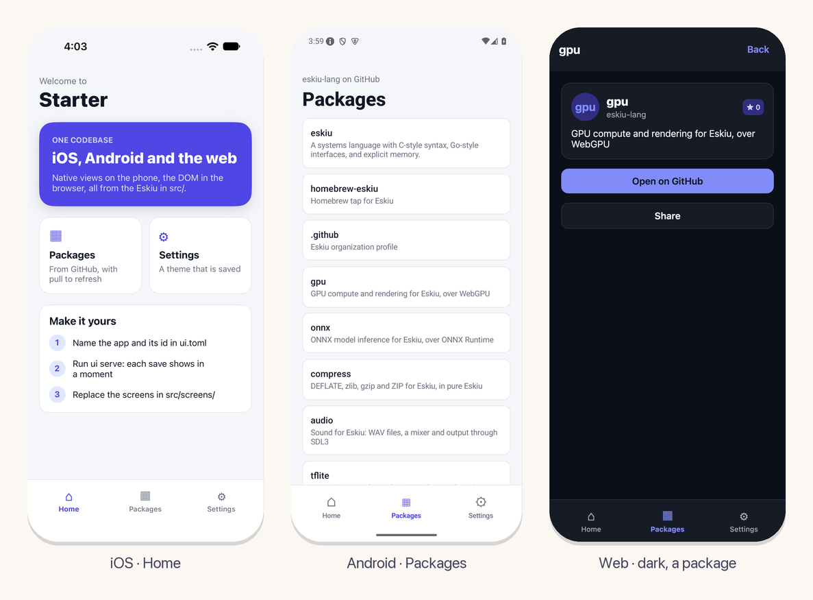

<p align="center">
  
</p>

<h2 align="center">ui-starter</h2>
<p align="center">An app to start from, on eskiu-lang/ui: tabs, screens, the network and a saved theme.</p>
<p align="center"><sub>Part of the <a href="https://github.com/eskiu-lang">Eskiu</a> project</sub></p>

<p align="center">
  <a href="https://github.com/eskiu-lang/ui-starter/actions/workflows/ci.yml"></a>
  <a href="LICENSE"></a>
</p>

---

`ui new` makes an app with one screen. This one has what most apps grow into: tabs along the
bottom, a stack of screens with links into them, a list loaded from the network with pull to
refresh, a setting saved on the device, light and dark themes, and tests that run without a
phone. It is one codebase for iOS, Android and the web. In a wide window (a tablet, or a
browser on a computer) the tabs become a sidebar, the content is centered and the kit's text
and controls are denser, so the web build looks like a web app.



## Start

1. **Use this template** on GitHub (or clone it).
2. Name the app in `ui.toml`: `name` (on the home screen), `id` (the bundle id and the Android
   package) and `scheme` (links like `starter://packages` open it). Rename the package in
   `eskiu.toml` if you like.
3. Run it, and keep it running while you work:

   ```bash
   ui serve              # the browser; each save shows in a moment
   ui serve ios          # the simulator, restarted in place on each save
   ui serve android      # a device or emulator
   ```

The [ui tool](https://github.com/eskiu-lang/ui/blob/main/docs/getting-started.md) needs
emscripten for the web, Xcode for iOS and the Android SDK for Android.

## What is in it

| Path | What it is |
|---|---|
| `src/main.esk` | The start: the model, then the root. |
| `src/app.esk` | The root: the theme, the routes and their screens, the tabs. |
| `src/model.esk` | The state that outlives the screens: the router, the saved theme, the packages from GitHub (`ui_fetch` and `<json>`). |
| `src/components/tabs.esk` | The tab bar along the bottom, the sidebar of a wide window, the screens' pages and large titles. |
| `src/screens/` | Home, Packages (a grid of cards, pull to refresh), a package's screen (a route with a parameter), Settings. |
| `tests/app.esk` | The JSON parsing, and the app rendered with no device: each screen, a load that works and one that fails, the dark theme. `eskiuc test` runs it. |
| `ui.toml` | The app's name, id and link scheme. |

The routes are `/`, `/packages`, `/packages/:name` and `/settings`. On the web they are the
page's URL, with the browser's back and forward; on the phone, screens that slide in, with the
back gesture. A tab resets the stack to its route.

## Next

- Add screens to `src/screens/` and a route for each in `src/app.esk`.
- Add a device package: [location](https://github.com/eskiu-lang/ui-location),
  [notifications](https://github.com/eskiu-lang/ui-notifications),
  [camera](https://github.com/eskiu-lang/ui-camera), or
  [your own](https://github.com/eskiu-lang/ui-package-template).
- The [ui docs](https://github.com/eskiu-lang/ui/tree/main/docs) cover state, components,
  style and layout, the platform, navigation and native code.

## License

MIT
